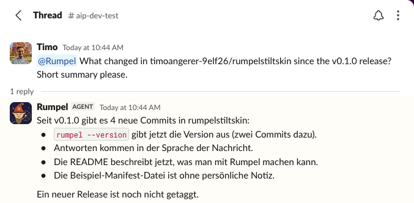

# rumpelstiltskin

A Slack bot for [Paseo](https://paseo.sh) agents. One binary, `rumpel`, does two jobs:

- `rumpel run` listens over Socket Mode and hands matching Slack messages to Paseo
  agents: a new agent per thread (or per channel, or per message), follow-ups to the
  same agent, Slack's loading indicator while it works.
- `rumpel post | read | upload | api` let any agent read and write Slack as the bot.
  The bot posts nothing on its own; the agent decides whether, where and how often it
  answers, and can post proactively.

Everyone runs their own bot: one Slack app per person, `rumpel run` on their own
machine, agents with that machine's logins and repos. Socket Mode splits a Slack app's
events across all open connections, so run exactly one `rumpel run` per app.

Not an official Slack or Paseo project.

## What you can do with it

- **Hand off work from any channel.** Mention the bot ("@Rumpel the export test is
  flaky again, find out why and open a PR"). It starts an agent in a fresh worktree
  of the repo you configured for that channel, shows Slack's "is working" indicator
  and answers in the thread. Follow-ups in the thread go to the same agent.
- **DM it like a colleague.** Direct messages can go to one long-running agent that
  keeps the conversation's context ("what did we decide about the retry logic
  yesterday?").
- **Forward a message with an emoji.** Add your bot's emoji (e.g. `:rumpel:`) to any
  message, a bug report from a customer channel or a question from a teammate, and
  the agent picks it up without anyone typing a mention.
- **Let long jobs report back.** The agent decides how often it writes: a short
  "on it", progress updates, the result with files attached (screenshots, reports),
  or nothing when nothing is needed.
- **Post from anywhere.** Scheduled agents and scripts on the same machine use
  `rumpel post` to send nightly reports or alerts as the bot instead of as you.
- **Give it a memory.** `rumpel init` creates a home repo with instructions, memory
  and skills that the agent keeps up to date and commits itself.



## Install

Prerequisites: a running Paseo daemon with Claude Code or Codex logged in, on macOS
(Apple Silicon) or Linux (x86_64, arm64).

```sh
curl --proto '=https' --tlsv1.2 -LsSf https://github.com/timoangerer-9elf26/rumpelstiltskin/releases/latest/download/rumpelstiltskin-installer.sh | sh
```

This puts `rumpel` in `~/.local/bin`. Rerun it to update. From source:
`cargo install --locked --git https://github.com/timoangerer-9elf26/rumpelstiltskin`.

## Setup (about 15 minutes)

1. **Create the Slack app.** `rumpel manifest --name <Name>` prints the app manifest.
   At [api.slack.com/apps](https://api.slack.com/apps): Create New App → From a
   manifest → paste it into the YAML tab. Install it to the workspace (your workspace
   admin may need to approve it). Under Basic Information → App-Level Tokens, create a
   token with scope `connections:write`.
2. **Run `rumpel setup`.** It asks for the bot token (OAuth & Permissions, `xoxb-…`),
   the app-level token (`xapp-…`), your Slack user id and a home repo for the agents,
   which it creates with `rumpel init` if needed. It writes `~/.config/rumpel/`
   (mode 700; token files 600), runs `rumpel check` and installs a service: a systemd
   user unit on Linux (`journalctl --user -u rumpel -f`), a launchd agent on macOS
   (`~/Library/Logs/rumpel.log`). On a Linux server, run
   `sudo loginctl enable-linger $USER` so it keeps running after you log out. Rerun
   `setup` any time; Enter keeps what is already there.
3. **Try it.** DM the bot. `/invite @<Name>` into a channel and @mention it there.
4. **Shape your agent.** Fill in the Context section of the home repo's `AGENTS.md`
   (who you are, the people and repos it works with), commit and push.

The starting config answers your DMs and your @mentions in every channel the bot is
in. Edit `~/.config/rumpel/config.toml` for more and restart the service.

## Security

Read this before you invite the bot anywhere.

- With `mode = "bypassPermissions"` (the default, because nobody is there to approve
  prompts) an agent may do anything your user account can do on that machine. **Every
  Slack message that triggers the bot is a command to your machine.**
- Keep `from = "owner"`. Use `from = "everyone"` or a list of ids only in channels
  whose members you would give a shell on that machine. Never in Slack Connect
  channels or anywhere with people from outside your organization.
- Prompt injection: the agent reads whatever text reaches it. A message you forward
  with the `reaction` emoji, a thread the agent reads, a file it opens: any of them
  can contain instructions. Treat what the agent can reach accordingly.
- The tokens live in `~/.config/rumpel/bot-token` and `app-token` with mode 600 so
  agents can use `rumpel post`. Every process of your user can read them. Anyone with
  the bot token can read and write wherever the bot is invited.
- `write_anywhere = false` (default) keeps agents to channels the bot was invited to.
  It is a policy for cooperative agents, not a sandbox: the token itself can post
  wherever its scopes allow.

## Config

`~/.config/rumpel/config.toml` (or `--config`). `config.example.toml` is a commented
template; `docs/examples/` holds a real setup. Read once at start: restart after
edits. Tokens come from `SLACK_BOT_TOKEN`/`SLACK_APP_TOKEN` or the two token files.

| Key | Default | Meaning |
|---|---|---|
| `owner` | required | Slack user id that `from = "owner"` means |
| `write_anywhere` | `false` | `false`: agents may write only in channels the bot is in (DMs and user ids always pass). `true`: anywhere, needs scope `chat:write.public` |
| `state_file` | `~/.local/state/rumpel/sessions.json` | session key → Paseo agent id, kept across restarts |
| `[paseo] bin` | `paseo` | path to the paseo CLI |
| `[paseo] host` | local daemon | `--host` for another daemon |
| `[paseo] provider` | `claude/sonnet` | provider/model for new agents |
| `[paseo] mode` | `bypassPermissions` | agent mode; anything else may stop on permission prompts |

Each `[[channel]]`:

| Key | Values | Meaning |
|---|---|---|
| `id` | channel id, `"dm"` or `"*"` | `"dm"` matches every direct message to the bot; `"*"` every channel the bot is in that has no entry of its own |
| `listen` | `mention`, `all` | trigger only on @mention, or on every message (thread replies included) |
| `from` | `"owner"`, `"everyone"`, `["U…", "B…"]` | who may trigger; other bots count as senders |
| `ignore` | `["U…", "B…"]` | never trigger, even if `from` allows them |
| `repo` | path | checkout the new agent's workspace is created from |
| `session` | `thread` (default), `channel`, `new` | one agent per Slack thread, per channel (per DM partner), or per message |
| `agent` | Paseo agent id | send every trigger to this existing agent instead of `repo`/`session` |
| `provider` | e.g. `claude/sonnet` | overrides `[paseo] provider` for this entry |
| `reaction` | emoji name, e.g. `"robot_face"` | adding this emoji to a message triggers on that message, no mention needed; `from`/`ignore` apply to whoever adds it; the answer goes to the message's thread |
| `workspace` | `worktree` (default), `local` | new agents get a fresh worktree of `repo`, or work in `repo` itself (needed to commit memory and skills) |
| `hints` | `true` (default), `false` | explain `rumpel` in every prompt; turn off when the repo's AGENTS.md does |
| `loading` | `true` (default), `false` | Slack's "is working" indicator; it only exists in a thread, so in DMs it opens one. `:eyes:` stays either way |

Every entry needs `repo` or `agent`. A changed `provider` applies to new agents only.
To make a thread or channel start fresh, delete its key from `state_file` and restart.

Configs stay backward compatible: new keys get defaults, and `CHANGELOG.md` notes
every change.

## The agent's home repo

An agent that should remember things and grow skills works in its own repo:

```sh
rumpel init ~/code/my-bot --name <Name>   # AGENTS.md, CLAUDE.md, memory/, .agents/skills/ (+ .claude/skills symlink)
```

The template (`template/`, embedded in the binary) holds the general part: how
messages arrive, how to answer with `rumpel`, memory, skills, committing. Point
channels at it with `workspace = "local"` and `hints = false`, as `rumpel setup` does.

## CLI

```sh
rumpel setup                               # tokens, config, home repo, service
rumpel manifest --name <Name>              # Slack app manifest
rumpel run                                 # listen and hand triggers to Paseo
rumpel check                               # config, bot token, app token
rumpel init <dir> --name <Name>            # agent home repo from the template
rumpel post C0… "text" [--thread TS]       # Markdown; text from stdin if omitted; prints the ts
rumpel post U0… "text"                     # DM to a person
rumpel read C0… [--thread TS] [--limit N]  # "ts [sender] text", oldest first
rumpel upload C0… ./file.png [--thread TS] [--comment "…"]
rumpel api chat.update '{"channel":"C0…","ts":"…","markdown_text":"…"}'
rumpel api reactions.add '{"channel":"C0…","timestamp":"…","name":"tada"}'
```

`api` calls any Web API method; non-string values (`blocks`, …) are sent as JSON.
Messages posted with `post` use `markdown_text`, so update them with `markdown_text`,
not `blocks`. `rumpel <command> --help` lists all flags.

## Per trigger

`:eyes:` on the message and the loading indicator in the thread
(`agents.sessions.setStatus`, renewed hourly); `paseo run` in a new workspace of
`repo`, or `paseo send` to the agent already mapped to the thread; the prompt tells
the agent where the message came from and how to use `rumpel`. The agent gets
`SLACK_CHANNEL` and `SLACK_THREAD_TS` in its environment. The bot itself posts only a
warning when an agent fails or waits for a permission.

If Slack rejects `agent_view` in the manifest (some AI features need a paid plan),
delete that block and the `assistant:write` scope; the bot then shows only `:eyes:`.

## Development

```sh
cargo test
RUMPEL_TEST_REPO=<git checkout> cargo test -- --ignored live_round_trip   # real Haiku agent via the local daemon
```

Releases: bump the version in `Cargo.toml`, add a `CHANGELOG.md` entry, tag `vX.Y.Z`
and push the tag; the release workflow (cargo-dist) builds the binaries.

## License

Apache-2.0
